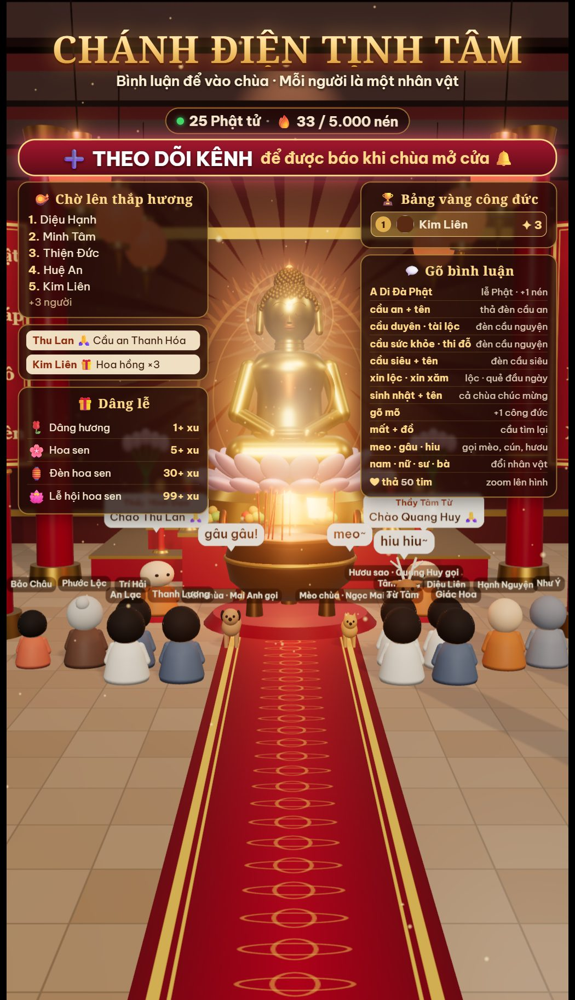
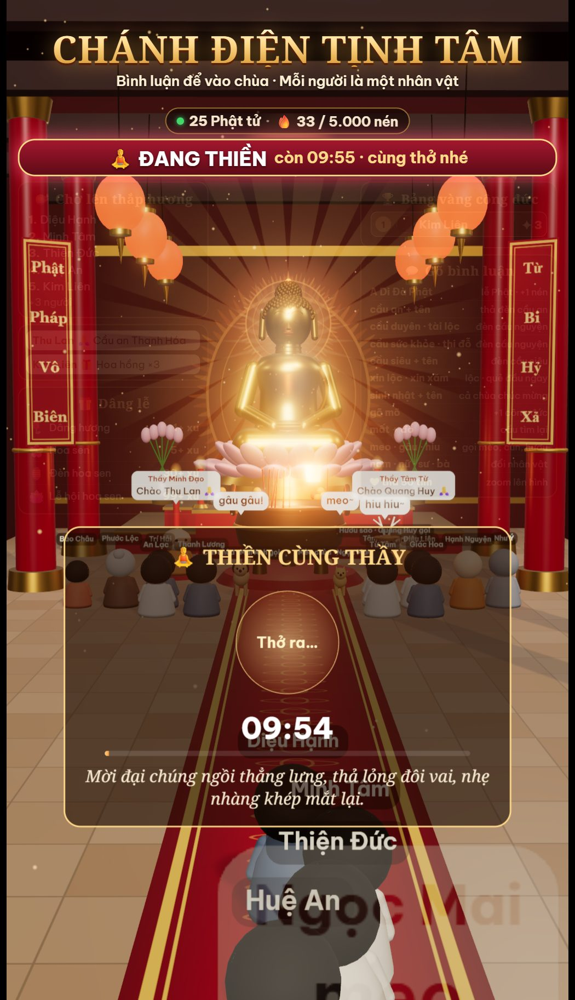
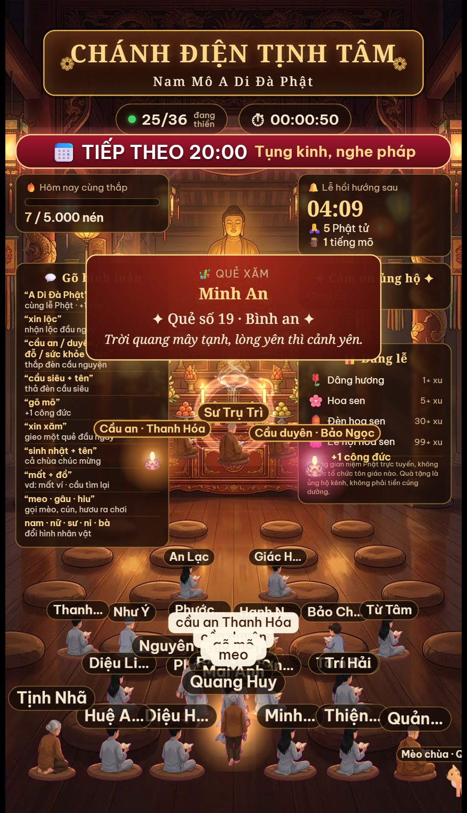

# Chánh Điện Tịnh Tâm

Chánh điện online cho TikTok LIVE, có hai giao diện **2.5D** và **3D**. Mỗi người xem bình luận là bước vào chánh điện. Ở bản 3D, nhân vật của họ đi theo thảm đỏ lên lư hương thắp nhang rồi đứng lại cùng đại chúng. Người xem cầu an, xin lộc, gõ mõ, gọi mèo chùa bằng bình luận. Ai tặng quà được xướng tên hồi hướng bằng giọng đọc tiếng Việt. Có nhạc thiền, chuông, mõ, lịch tụng kinh và thiền dẫn.

<p align="center">
  
  
  
</p>

Mã nguồn miễn phí (MIT), phát triển tiếp từ [Chánh Điện Online của Kent Juno](https://github.com/kentjuno/chanh-dien-online).

## Có gì

| | 2.5D (`overlay.html`) | 3D (`overlay3d.html`) |
|---|---|---|
| Hình | Ảnh nền chánh điện vẽ sẵn, nhân vật 2D ngồi bồ đoàn | Chánh điện dựng bằng three.js: cột son, đèn lồng, lư hương có khói, tượng Phật vàng, hào quang phát sáng |
| Người xem | Đi vào và ngồi xuống bồ đoàn | Đi theo thảm đỏ, xếp hàng, cúi lạy thắp hương, rồi đứng vào hàng. Có ảnh đại diện TikTok trên đầu |
| Camera | Zoom vào người thả đủ tim | Bám theo người mới vào, xoay vòng quanh khi họ lạy; lướt về phía tượng mỗi 90 giây |
| Máy cần | Máy nào cũng chạy | Nên có card đồ họa rời; có chế độ `?q=low` cho máy yếu |

Cả hai dùng chung một server và một bảng điều khiển, chọn giao diện nào để phát cũng được.

## Chạy thử

Cần [Node.js](https://nodejs.org) 20 trở lên.

```bash
cd live
npm install
npm start
```

1. Mở `http://localhost:3000/live/control.html` (bảng điều khiển).
2. Bấm **Mở màn hình overlay 9:16** hoặc **Mở overlay 3D**, rồi bấm **Bật âm thanh** một lần trong cửa sổ đó (trình duyệt chặn tự phát tiếng).
3. Đưa lên live:
   - **OBS:** thêm *Browser source* trỏ tới `http://localhost:3000/live/overlay.html` (hoặc `overlay3d.html`), kích thước 1080×1920. Chuột phải nguồn → *Interact* → bấm **Bật âm thanh**. Với bản 3D, bật *Browser Source Hardware Acceleration* trong Settings → Advanced.
   - **TikTok LIVE Studio:** *Add source → Window capture* → chọn cửa sổ overlay.
4. Bật LIVE trên TikTok, nhập `@username` vào bảng điều khiển, bấm **Kết nối**.

Chưa live vẫn thử được: các nút **Thử tương tác**, **Thử quà**, **Đổ người mẫu**.

Tham số cho overlay 3D: `?fps=1` hiện số khung hình mỗi giây, `?q=low` giảm chất lượng cho máy yếu.

## Người xem làm được gì

| Bình luận | Điều xảy ra |
|---|---|
| bất kỳ | Được vào chánh điện (tối đa 100 người, chỗ tự mở rộng) |
| `A Di Đà Phật`, `Nam mô` | Cúi lạy, +1 nén hương |
| `cầu an` / `cầu duyên` / `cầu tài lộc` / `cầu sức khỏe` / `cầu thi đỗ` + tên | Thả đèn cầu nguyện theo màu, giọng đọc lời nguyện |
| `cầu siêu` + tên | Thả đèn cầu siêu |
| `xin lộc` | Rút một lá lộc (mỗi người một lá mỗi ngày) |
| `xin xăm` | Gieo quẻ |
| `sinh nhật` + tên | Cả chùa chúc mừng, mưa hoa |
| `gõ mõ` | Tiếng mõ, +1 công đức |
| `mất` + đồ (vd `mất ví`) | Cầu tìm lại |
| `meo` · `gâu` · `hiu` | Gọi mèo, cún, hươu ra chơi |
| `nam` · `nữ` · `sư` · `ni` · `bà` … (đúng một từ) | Đổi hình nhân vật |

Ngoài ra:
- **Thả tim:** mỗi tim là một nén hương cho mục tiêu chung trong ngày. Một người thả đủ 50 tim (đổi được) thì camera zoom vào họ. Cả phòng thả đủ 300 tim trong một phút thì có khoảnh khắc "đại chúng đồng tâm".
- **Tặng quà:** giá trị quà chọn nghi lễ (Dâng hương, Hoa sen, Đèn hoa sen, Lễ hội hoa sen), xướng tên hồi hướng, lên Bảng vàng công đức.
- **Theo dõi, chia sẻ:** cảm ơn bằng giọng đọc.

## Bảng điều khiển

- **Lịch phát:** mỗi dòng `giờ:phút nội dung`, hiện trên băng rôn "Tiếp theo". Dòng có chữ "thiền" tự bắt đầu **thiền dẫn** đúng giờ: vòng tròn hít thở, đồng hồ và 12 lời dẫn đọc bằng giọng nói.
- **Đọc kinh và hồi hướng định kỳ**, đọc tên những người đã tặng quà hoặc cầu nguyện.
- **Mục tiêu nén hương** theo ngày, có mốc chúc mừng.
- **Giọng đọc** Nam Minh hoặc Hoài My, chỉnh cao độ và tốc độ, phát câu tùy ý lên live.

## Tượng 3D của riêng bạn

Bản 3D có sẵn tượng Phật vàng dựng bằng code. Muốn dùng mẫu tượng thật, đặt file `buddha.glb` vào `assets/models/` rồi tải lại overlay. Tượng tự được căn kích thước, đặt lên bàn thờ và canh hào quang. Mẫu không có texture sẽ được phủ vàng.

- Chỉ dùng mẫu mà giấy phép cho phép dùng trên livestream (nhất là khi có nhận quà).
- Mẫu nặng nên giảm còn vài trăm nghìn tam giác, ví dụ bằng [glTF-Transform](https://gltf-transform.dev): `gltf-transform simplify in.glb out.glb --ratio 0.2`.
- `assets/models/*.glb` nằm trong `.gitignore`, nên mẫu đã mua không bị đẩy lên GitHub.

## Cấu trúc

| Đường dẫn | Là gì |
|---|---|
| `live/server.mjs` | Server Node: đọc sự kiện TikTok, từ khóa, quà, giọng đọc, lịch, thiền dẫn |
| `live/control.html` | Bảng điều khiển |
| `live/overlay.html` | Giao diện 2.5D |
| `live/overlay3d.html` | Giao diện 3D |
| `assets/` | Hình, nhạc; `assets/vendor/three` là three.js r187 (MIT) |
| `index.html` | Bản web tĩnh cho mọi người tự vào ngồi tụng |

## Dùng có trách nhiệm

- **Người mẫu, bot mô phỏng và câu nói vui của người mẫu chỉ để chạy thử.** Chúng làm phòng trông đông hơn thực tế, nên TikTok có thể coi là tương tác giả và khóa kênh. Câu nói vui tắt sẵn; bot không bao giờ tặng quà. Câu vui chỉ gắn với người mẫu và các thầy, không bao giờ gắn với tên người xem thật.
- Đọc kỹ [Nguyên tắc cộng đồng](https://www.tiktok.com/community-guidelines) và quy định LIVE của TikTok trước khi phát.
- Giữ sự tôn kính khi dùng hình ảnh, kinh văn Phật giáo.

## Bảo mật

Dự án được viết để ai tải về chạy cũng an toàn mặc định:

- **Không dùng tài khoản TikTok.** Server chỉ đọc sự kiện công khai của phòng live theo username. Không cần, không hỏi và không lưu mật khẩu, cookie hay session. Không gửi tin nhắn thay bạn.
- **Chỉ mở trên máy mình.** Server lắng nghe `127.0.0.1`, máy khác trong mạng hay Internet không truy cập được. Muốn mở ra ngoài phải tự đặt biến `HOST`. Không nên làm vậy khi chưa thêm đăng nhập.
- **Chặn trang web lạ điều khiển.** WebSocket chỉ nhận kết nối từ chính trang của server (kiểm tra `Origin`), và header `Host` phải là localhost (chống DNS rebinding). Một trang web khác đang mở trong cùng trình duyệt không gửi được lệnh. Cửa sổ overlay chỉ nhận dữ liệu, không gửi lệnh được.
- **File tĩnh có danh sách trắng.** Chỉ phục vụ `/assets` và `/live`. Chặn file ẩn (`.git`, `.env`), `node_modules`, mã server, `package.json` và mọi đường dẫn `../`.
- **Không tin dữ liệu vào.** Tên người xem, bình luận và tên quà đều bị cắt độ dài. Cài đặt chỉ nhận đúng khóa, đúng kiểu, trong giới hạn. Văn bản đưa vào giọng đọc được escape XML. Mọi chữ trên màn hình vẽ bằng `textContent` hoặc canvas, không chèn HTML, nên bình luận chứa mã độc chỉ hiện ra như chữ thường.
- **Chống spam.** Hàng đợi giọng đọc tối đa 15 câu; câu của từ khóa nhường chỗ cho câu cảm ơn quà. Mỗi từ khóa có thời gian chờ riêng cho từng người.
- **Phụ thuộc ghim phiên bản** trong `live/package.json`: `ws`, `msedge-tts`, `tiktok-live-connector`. Không có khóa API nào trong mã.
- **Dữ liệu trong ngày** (`live/data.json`: số nén hương, ID người xem, lộc đã rút) và file giọng đọc tạm (`live/tts/`) chỉ nằm trên máy phát và không được đưa lên git.

### Lưu ý

- `tiktok-live-connector` là thư viện cộng đồng, không phải API chính thức của TikTok. Nó có thể ngừng chạy khi TikTok đổi hệ thống. Kiểm tra điều khoản TikTok trước khi dùng cho kênh của bạn.
- Giọng đọc dùng dịch vụ Read Aloud của Microsoft Edge qua mạng (giọng Nam Minh, Hoài My). Máy phát cần có Internet.
- Hình ảnh trong `assets/` được tạo bằng Google Flow, nhạc nền tạo bằng Gemini. Kiểm tra điều khoản của các dịch vụ đó trước khi dùng thương mại, hoặc thay bằng tài nguyên của bạn.

## Ghi công và giấy phép

- Dự án gốc: [Chánh Điện Online](https://github.com/kentjuno/chanh-dien-online) của **Kent Juno**, giấy phép MIT (xem `LICENSE`).
- Đồ họa 3D: [three.js](https://threejs.org) (MIT), bản r187 kèm giấy phép trong `assets/vendor/three/LICENSE`.
- Phần mở rộng (từ khóa, nghi lễ, mục tiêu, lịch phát, thiền dẫn, giao diện 3D) phát hành cùng giấy phép MIT.

## Miễn trừ trách nhiệm

Dự án được chia sẻ **miễn phí, với mục đích học tập và tham khảo lập trình**. Phần mềm được cung cấp "nguyên trạng" (AS IS), không kèm bất kỳ bảo đảm nào, rõ ràng hay ngụ ý.

Khi tải về, sử dụng, chỉnh sửa hoặc phân phối lại mã nguồn này, **bạn tự chịu hoàn toàn trách nhiệm** về:

- Mọi nội dung bạn phát trên livestream hoặc đăng tải, bao gồm hình ảnh, âm thanh, giọng đọc, lời nguyện, bình luận được hiển thị.
- Việc nhận quà, donation hoặc bất kỳ khoản thu nào từ người xem.
- Việc tuân thủ điều khoản sử dụng của TikTok và các nền tảng, dịch vụ bên thứ ba khác (thư viện đọc sự kiện TikTok là thư viện cộng đồng, không chính thức).
- Việc tuân thủ pháp luật nơi bạn sinh sống và hoạt động, kể cả quy định về hoạt động tôn giáo, quảng cáo, thuế và bản quyền.
- Mọi rủi ro và thiệt hại phát sinh, trực tiếp hay gián tiếp, như bị khóa tài khoản, bị dừng live, mất dữ liệu, tranh chấp hay khiếu nại.

Tác giả **không liên quan, không bảo trợ và không chịu trách nhiệm** đối với bất kỳ kênh, tài khoản, sản phẩm hay hoạt động nào sử dụng mã nguồn này. Dự án không đại diện cho bất kỳ chùa, tu viện hay tổ chức tôn giáo nào. Khi dùng nội dung liên quan đến Phật giáo, xin giữ sự tôn kính và không dùng vào mục đích lừa đảo, trục lợi hay xúc phạm niềm tin của người khác.

Việc sử dụng mã nguồn đồng nghĩa với việc bạn đã đọc và đồng ý với các điều trên.

> **Disclaimer (EN):** This project is shared free of charge for educational purposes only and is provided "AS IS", without warranty of any kind. Anyone who uses, modifies or redistributes it is solely responsible for their own content, streams, donations, compliance with TikTok and other platforms' terms, and applicable laws. The author is not affiliated with, does not endorse, and accepts no liability for any channel, account, product or activity built with this code, nor for any direct or indirect damages.
